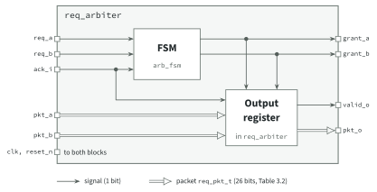

# 2. Design Overview

## 2.1 Organization

`req_arbiter` contains the grant state machine `FSM` (module `arb_fsm`) and
the output register, which is logic of `req_arbiter` itself (Figure 2.1).
One clock `clk` and one asynchronous active-low reset `reset_n` drive both.

**Figure 2.1.** Organization of `req_arbiter`. Clock and reset go to both blocks.

- **Grant state machine (`FSM`):** decides which port is served, grants it
  for one cycle, and waits for the acknowledgement of the output. It
  remembers which port was served last, to alternate. Chapter 4 describes
  it.
- **Output register:** takes the packet of the granted port in the grant
  cycle and holds it, with `valid_o` high, until the acknowledgement.

The design has no parameters. The widths of the request packet are fixed in
the package `arb_pkg` (Table 3.2).
