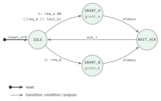
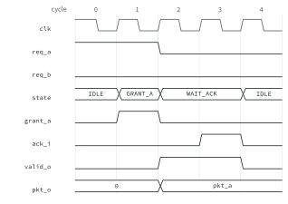

# 4. Arbitration

## 4.1 Grant State Machine

The grant state machine of Figure 4.1 has four states, encoded in two bits.
Table 4.1 gives every transition. Each state is kept when none of its
transition conditions holds.

**Figure 4.1.** Grant state machine of `arb_fsm`. Outputs inside a state are high in that state.

**Table 4.1.** Transitions of the grant state machine.

| Current state | Condition (priority) | Next state | Outputs in the next state |
|---|---|---|---|
| `IDLE` (0) | `req_a && (!req_b || last_b)` (1) | `GRANT_A` | `grant_a` = 1 |
| `IDLE` | `req_b` (2) | `GRANT_B` | `grant_b` = 1 |
| `GRANT_A` (1) | always | `WAIT_ACK` | -- |
| `GRANT_B` (2) | always | `WAIT_ACK` | -- |
| `WAIT_ACK` (3) | `ack_i` | `IDLE` | -- |

`last_b` records the port served last: it is set in `GRANT_B` and cleared
in `GRANT_A`. Reset sets it, so that port A wins the first tie. When both
ports request in `IDLE`, the port that was not served last is granted.

## 4.2 One Transfer

Figure 4.2 shows a transfer from port A. In cycle 0 `req_a` is high in
`IDLE`; in cycle 1 the state is `GRANT_A` and `grant_a` is high; the output
register takes `pkt_a` at the end of cycle 1, so `valid_o` is high from
cycle 2; `ack_i` in cycle 3 returns the state to `IDLE` and clears `valid_o`
in cycle 4. `pkt_o` keeps its value after the acknowledgement.

**Figure 4.2.** One transfer from port A.
