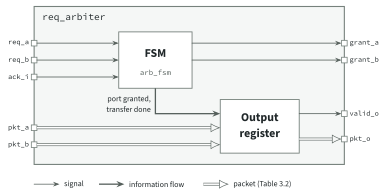
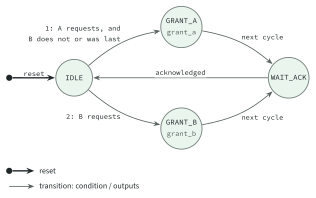
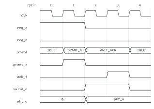

<!-- GENERATED by specforge from the project's chapter files. Do not edit by hand. -->

# Request Arbiter (ARB) — Design Specification

## Document Information

| Item | Value |
|---|---|
| Document type | Design Specification |
| Design | Request Arbiter (ARB) |
| Diagram level | High-level |
| Revision | 1.0 |
| Date | 25 November 2026 |
| Author | specforge example |
| Status | Example |

## Revision History

| Revision | Date | Description |
|---|---|---|
| 1.0 | 25 November 2026 | Example document. |

## Table of Contents

- [1. Introduction](#1-introduction)
  - [1.1 Purpose and Scope](#11-purpose-and-scope)
  - [1.2 Terminology](#12-terminology)
- [2. Design Overview](#2-design-overview)
  - [2.1 Organization](#21-organization)
- [3. Interfaces](#3-interfaces)
  - [3.1 External Signals](#31-external-signals)
  - [3.2 Request Packet](#32-request-packet)
  - [3.3 Protocol](#33-protocol)
- [4. Arbitration](#4-arbitration)
  - [4.1 Grant State Machine](#41-grant-state-machine)
  - [4.2 One Transfer](#42-one-transfer)

---

# 1. Introduction

## 1.1 Purpose and Scope

The Request Arbiter (`req_arbiter`) is an invented example design of
specforge. It forwards request packets from two ports, A and B, to one
output, one packet at a time, and alternates between the ports when both
request in the same cycle. This document describes the complete design:
its organization, every interface signal, the request packet, the grant
state machine and the timing of one transfer.

## 1.2 Terminology

**Table 1.1.** Terms used in this document.

| Term | Meaning |
|---|---|
| Port | One of the two request sources, A or B. |
| Request packet | The `req_pkt_t` structure that a port sends with its request. |
| Grant | The one-cycle signal that tells a port that its packet is taken. |
| Transfer | One packet, from its grant to the acknowledgement of the output. |

---

# 2. Design Overview

## 2.1 Organization

`req_arbiter` contains the grant state machine `FSM` (module `arb_fsm`) and
the output register, which is logic of `req_arbiter` itself (Figure 2.1).
One clock `clk` and one asynchronous active-low reset `reset_n` drive both.

**Figure 2.1.** Organization of `req_arbiter`. Clock and reset go to both blocks.

- **Grant state machine (`FSM`):** decides which port is served, grants it
  for one cycle, and waits for the acknowledgement of the output. It
  remembers which port was served last, to alternate. Chapter 4 describes
  it.
- **Output register:** takes the packet of the granted port in the grant
  cycle and holds it, with `valid_o` high, until the acknowledgement.

The design has no parameters. The widths of the request packet are fixed in
the package `arb_pkg` (Table 3.2).

---

# 3. Interfaces

## 3.1 External Signals

Table 3.1 lists every signal of `req_arbiter`. All outputs change on the
rising edge of `clk`.

**Table 3.1.** Signals of `req_arbiter`.

| Signal | Width | Direction | Description |
|---|---|---|---|
| `clk` | 1 | Input | Clock. |
| `reset_n` | 1 | Input | Asynchronous reset, active low. Resets the state to `IDLE`, `valid_o` and `pkt_o` to 0, and makes port A win the first tie. |
| `req_a` | 1 | Input | Port A has a packet on `pkt_a`. Held until `grant_a`. |
| `pkt_a` | 26 | Input | Request packet of port A (`req_pkt_t`, Table 3.2). Valid while `req_a` is high. |
| `req_b` | 1 | Input | Port B has a packet on `pkt_b`. Held until `grant_b`. |
| `pkt_b` | 26 | Input | Request packet of port B (`req_pkt_t`). Valid while `req_b` is high. |
| `ack_i` | 1 | Input | The output has taken `pkt_o`. Ends the transfer. |
| `grant_a` | 1 | Output | High for one cycle when the packet of port A is taken. |
| `grant_b` | 1 | Output | High for one cycle when the packet of port B is taken. |
| `valid_o` | 1 | Output | `pkt_o` holds a packet. High from the cycle after the grant until the cycle after `ack_i`. |
| `pkt_o` | 26 | Output | The forwarded request packet (`req_pkt_t`). Valid while `valid_o` is high. |

## 3.2 Request Packet

**Table 3.2.** Fields of the request packet `req_pkt_t`, from the most significant bit.

| Field | Width | Meaning |
|---|---|---|
| `id` | 2 | Identifier of the request. |
| `addr` | 8 | Address. |
| `data` | 16 | Data. |

The arbiter does not interpret the fields; it forwards the packet
unchanged.

## 3.3 Protocol

A port raises its request with a packet and holds both until its grant. The
output acknowledges a packet with `ack_i` while `valid_o` is high; the
next transfer can be granted from the cycle after the acknowledgement.
Figure 4.2 shows one transfer.

---

# 4. Arbitration

## 4.1 Grant State Machine

The grant state machine of Figure 4.1 has four states, encoded in two bits.
Table 4.1 gives every transition. Each state is kept when none of its
transition conditions holds.

**Figure 4.1.** Grant state machine of `arb_fsm`. Outputs inside a state are high in that state.

**Table 4.1.** Transitions of the grant state machine.

| Current state | Condition (priority) | Next state | Outputs in the next state |
|---|---|---|---|
| `IDLE` (0) | `req_a && (!req_b || last_b)` (1) | `GRANT_A` | `grant_a` = 1 |
| `IDLE` | `req_b` (2) | `GRANT_B` | `grant_b` = 1 |
| `GRANT_A` (1) | always | `WAIT_ACK` | -- |
| `GRANT_B` (2) | always | `WAIT_ACK` | -- |
| `WAIT_ACK` (3) | `ack_i` | `IDLE` | -- |

`last_b` records the port served last: it is set in `GRANT_B` and cleared
in `GRANT_A`. Reset sets it, so that port A wins the first tie. When both
ports request in `IDLE`, the port that was not served last is granted.

## 4.2 One Transfer

Figure 4.2 shows a transfer from port A. In cycle 0 `req_a` is high in
`IDLE`; in cycle 1 the state is `GRANT_A` and `grant_a` is high; the output
register takes `pkt_a` at the end of cycle 1, so `valid_o` is high from
cycle 2; `ack_i` in cycle 3 returns the state to `IDLE` and clears `valid_o`
in cycle 4. `pkt_o` keeps its value after the acknowledgement.

**Figure 4.2.** One transfer from port A.
