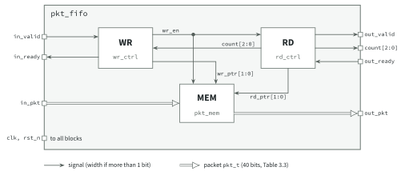

# 2. Design Overview

## 2.1 Organization

`pkt_fifo` contains three blocks (Figure 2.1). The clock `clk` and the
asynchronous active-low reset `rst_n` go to all three.

**Figure 2.1.** Organization of `pkt_fifo`.

- **Write control (`WR`, module `wr_ctrl`):** keeps the write pointer
  `wr_ptr`, raises `wr_en` for each write, and drives `in_ready` from
  `count`.
- **Packet memory (`MEM`, module `pkt_mem`):** four entries of `pkt_t`.
  It stores `in_pkt` at `wr_ptr` when `wr_en` is high and presents the
  entry at `rd_ptr` as `out_pkt`.
- **Read control (`RD`, module `rd_ctrl`):** keeps the read pointer
  `rd_ptr` and the counter `count`, and runs the read state machine that
  drives `out_valid` (Section 4.2).

The depth of four packets and the widths are fixed; the design has no
parameters.
