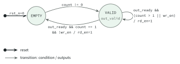

# 4. Operation

## 4.1 Write

A write happens at a rising edge of `clk` when `in_valid` and `in_ready`
are both high. `MEM` stores `in_pkt` at `wr_ptr`, `wr_ptr` advances by one
(from 3 to 0), and `count` increases by one unless a read happens in the
same cycle. `in_ready` is low while `count` is 4.

## 4.2 Read

The read state machine of `RD` (Figure 4.1, Table 4.1) drives `out_valid`.
A read happens when `out_valid` and `out_ready` are both high: `rd_en` is
high, `rd_ptr` advances by one, and `count` decreases by one unless a
write happens in the same cycle.

**Figure 4.1.** Read state machine of `rd_ctrl`. A state is kept when none of its conditions holds.

**Table 4.1.** Transitions of the read state machine.

| Current state | Condition | Next state | Outputs |
|---|---|---|---|
| `EMPTY` | `count != 0` | `VALID` | -- |
| `VALID` | `out_ready && count == 1 && !wr_en` | `EMPTY` | `rd_en` = 1 |
| `VALID` | `out_ready && (count > 1 || wr_en)` | `VALID` | `rd_en` = 1 |

`out_valid` is 1 in `VALID` and 0 in `EMPTY`. Reset puts the machine in
`EMPTY`. After a read that leaves packets stored, `out_pkt` shows the next
packet from the next cycle.

## 4.3 Simultaneous Operations and Reset

**Table 4.2.** Outcome of a write and a read in the same cycle.

| Write | Read | Outcome |
|---|---|---|
| no | no | Nothing changes. |
| yes | no | Packet stored; `count` + 1. |
| no | yes | Oldest packet read; `count` - 1. |
| yes | yes | Both done; `count` unchanged. |

When the FIFO is full, `in_ready` is low even if a read happens in the
same cycle, so no write happens in that cycle.

Reset empties the FIFO: `count`, `wr_ptr` and `rd_ptr` become 0, the read
state machine goes to `EMPTY` and `out_valid` to 0. The memory contents
are not reset.
