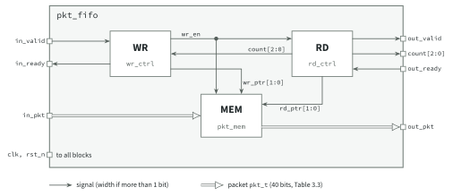
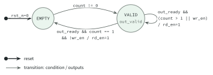

<!-- GENERATED by specforge from the project's chapter files. Do not edit by hand. -->

# Packet FIFO (PFIFO) — Design Specification

## Document Information

| Item | Value |
|---|---|
| Document type | Design Specification |
| Design | Packet FIFO (PFIFO) |
| Diagram level | Detailed |
| Revision | 1.0 |
| Date | 25 November 2026 |
| Author | specforge example |
| Status | Example |

## Revision History

| Revision | Date | Description |
|---|---|---|
| 1.0 | 25 November 2026 | Example document. |

## Table of Contents

- [1. Introduction](#1-introduction)
  - [1.1 Purpose and Scope](#11-purpose-and-scope)
  - [1.2 Terminology](#12-terminology)
- [2. Design Overview](#2-design-overview)
  - [2.1 Organization](#21-organization)
- [3. Interfaces](#3-interfaces)
  - [3.1 External Signals](#31-external-signals)
  - [3.2 Signals between the Blocks](#32-signals-between-the-blocks)
  - [3.3 Packet](#33-packet)
- [4. Operation](#4-operation)
  - [4.1 Write](#41-write)
  - [4.2 Read](#42-read)
  - [4.3 Simultaneous Operations and Reset](#43-simultaneous-operations-and-reset)

---

# 1. Introduction

## 1.1 Purpose and Scope

The Packet FIFO (`pkt_fifo`) is an invented example design of specforge.
It buffers up to four packets between a producer and a consumer on the
same clock; both sides use a valid/ready handshake. This document
describes the complete design: its blocks, every interface signal, the
packet, the read state machine and the outcome of simultaneous operations.

## 1.2 Terminology

**Table 1.1.** Terms used in this document.

| Term | Meaning |
|---|---|
| Producer | The block that writes packets into `pkt_fifo`. |
| Consumer | The block that reads packets from `pkt_fifo`. |
| Write | A cycle in which `in_valid` and `in_ready` are both high. |
| Read | A cycle in which `out_valid` and `out_ready` are both high. |

---

# 2. Design Overview

## 2.1 Organization

`pkt_fifo` contains three blocks (Figure 2.1). The clock `clk` and the
asynchronous active-low reset `rst_n` go to all three.

**Figure 2.1.** Organization of `pkt_fifo`.

- **Write control (`WR`, module `wr_ctrl`):** keeps the write pointer
  `wr_ptr`, raises `wr_en` for each write, and drives `in_ready` from
  `count`.
- **Packet memory (`MEM`, module `pkt_mem`):** four entries of `pkt_t`.
  It stores `in_pkt` at `wr_ptr` when `wr_en` is high and presents the
  entry at `rd_ptr` as `out_pkt`.
- **Read control (`RD`, module `rd_ctrl`):** keeps the read pointer
  `rd_ptr` and the counter `count`, and runs the read state machine that
  drives `out_valid` (Section 4.2).

The depth of four packets and the widths are fixed; the design has no
parameters.

---

# 3. Interfaces

## 3.1 External Signals

**Table 3.1.** Signals of `pkt_fifo`.

| Signal | Width | Direction | Description |
|---|---|---|---|
| `clk` | 1 | Input | Clock. |
| `rst_n` | 1 | Input | Asynchronous reset, active low. Empties the FIFO. |
| `in_valid` | 1 | Input | The producer offers `in_pkt`. |
| `in_ready` | 1 | Output | The FIFO can take a packet. Low when `count` is 4. |
| `in_pkt` | 40 | Input | The offered packet (`pkt_t`, Table 3.3). |
| `out_valid` | 1 | Output | `out_pkt` holds the oldest packet. |
| `out_ready` | 1 | Input | The consumer takes `out_pkt`. |
| `out_pkt` | 40 | Output | The oldest stored packet (`pkt_t`). Valid while `out_valid` is high. |
| `count` | 3 | Output | Number of stored packets, 0 to 4. |

## 3.2 Signals between the Blocks

**Table 3.2.** Signals between the blocks of `pkt_fifo`.

| Signal | Width | From, to | Description |
|---|---|---|---|
| `wr_en` | 1 | `WR` to `MEM`, `RD` | A write happens in this cycle. |
| `wr_ptr` | 2 | `WR` to `MEM` | Entry that the next write uses. |
| `rd_ptr` | 2 | `RD` to `MEM` | Entry of the oldest packet. |
| `count` | 3 | `RD` to `WR` | Number of stored packets. |

## 3.3 Packet

**Table 3.3.** Fields of the packet `pkt_t`, from the most significant bit.

| Field | Width | Meaning |
|---|---|---|
| `len` | 8 | Number of valid payload bytes, 1 to 4. |
| `payload` | 32 | The data. |

`pkt_fifo` stores and returns packets unchanged; it does not check `len`.

---

# 4. Operation

## 4.1 Write

A write happens at a rising edge of `clk` when `in_valid` and `in_ready`
are both high. `MEM` stores `in_pkt` at `wr_ptr`, `wr_ptr` advances by one
(from 3 to 0), and `count` increases by one unless a read happens in the
same cycle. `in_ready` is low while `count` is 4.

## 4.2 Read

The read state machine of `RD` (Figure 4.1, Table 4.1) drives `out_valid`.
A read happens when `out_valid` and `out_ready` are both high: `rd_en` is
high, `rd_ptr` advances by one, and `count` decreases by one unless a
write happens in the same cycle.

**Figure 4.1.** Read state machine of `rd_ctrl`. A state is kept when none of its conditions holds.

**Table 4.1.** Transitions of the read state machine.

| Current state | Condition | Next state | Outputs |
|---|---|---|---|
| `EMPTY` | `count != 0` | `VALID` | -- |
| `VALID` | `out_ready && count == 1 && !wr_en` | `EMPTY` | `rd_en` = 1 |
| `VALID` | `out_ready && (count > 1 || wr_en)` | `VALID` | `rd_en` = 1 |

`out_valid` is 1 in `VALID` and 0 in `EMPTY`. Reset puts the machine in
`EMPTY`. After a read that leaves packets stored, `out_pkt` shows the next
packet from the next cycle.

## 4.3 Simultaneous Operations and Reset

**Table 4.2.** Outcome of a write and a read in the same cycle.

| Write | Read | Outcome |
|---|---|---|
| no | no | Nothing changes. |
| yes | no | Packet stored; `count` + 1. |
| no | yes | Oldest packet read; `count` - 1. |
| yes | yes | Both done; `count` unchanged. |

When the FIFO is full, `in_ready` is low even if a read happens in the
same cycle, so no write happens in that cycle.

Reset empties the FIFO: `count`, `wr_ptr` and `rd_ptr` become 0, the read
state machine goes to `EMPTY` and `out_valid` to 0. The memory contents
are not reset.
